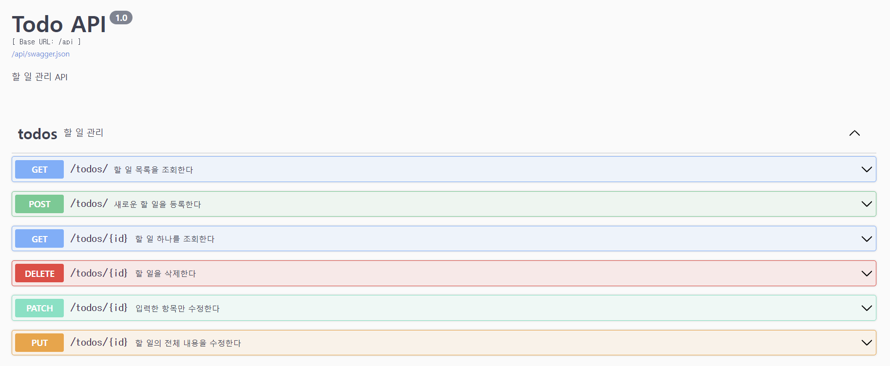
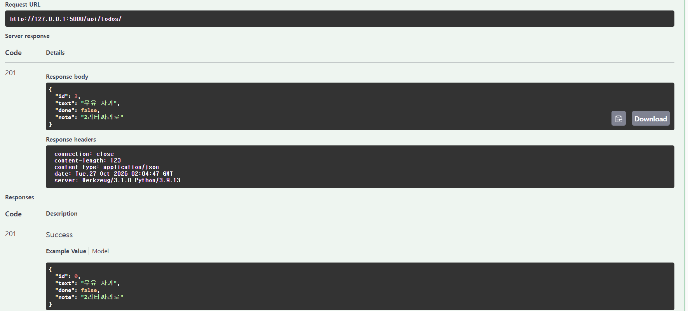
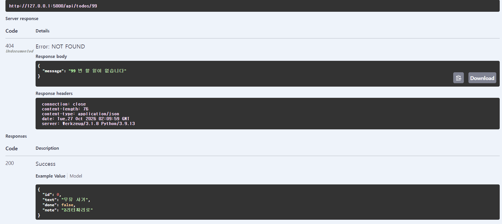

# HW4 : Todo 앱에 API 더하기

## 추가한 기능

- 설명 칸(note)을 API로 주고받을 수 있습니다.
- 완료 여부에 따라 할 일 목록을 필터링할 수 있습니다.
- 할 일의 등록, 조회, 수정, 삭제 API를 제공합니다.

## 실행 방법

필요한 패키지 설치:

```bash
pip install -r requirements.txt
```

앱 실행:

```bash
flask --debug run
```

- 할 일 화면: http://127.0.0.1:5000/
- API 문서: http://127.0.0.1:5000/api/docs

## 실행 화면

### 1. API 문서



### 2. 설명을 포함한 할 일 등록



### 3. 없는 할 일 조회

